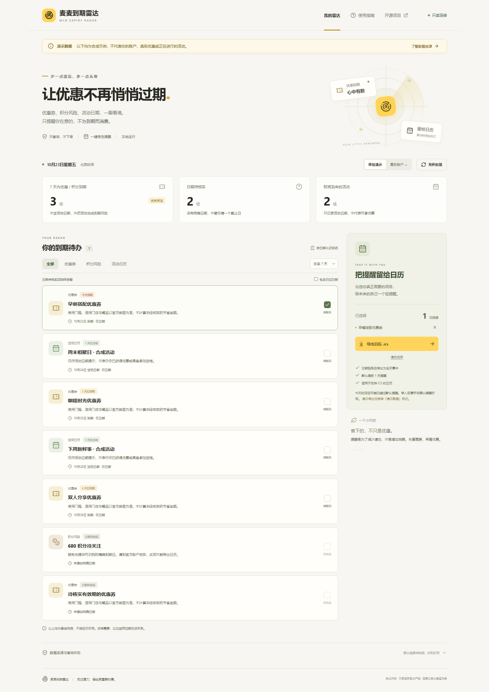

# 麦麦到期雷达

**让优惠不再悄悄过期，把提醒留给日历。**

基于麦当劳中国 MCP 的中文本地网页 + 可复用 Skill。只读查询优惠券、即将过期积分和活动日历，整理到期待办，再把你真正需要的项目导入自己的日历。**不自动领券、下单、兑换、抽奖或消耗积分，不为到期而鼓励消费。**

> 独立开发的非官方参赛作品，无官方背书。**当前没有使用真实账户 Token 完成联调**；已实现官方 MCP 连接、工具发现与校验链路，并用合成 MCP 服务验证。演示数据不是官方返回，也不代表真实优惠。参赛资格最终由组织方审核，不能仅凭本仓库文件宣称已报名成功。



## 为谁解决什么问题

适合想减少遗忘、但不想为优惠增加消费的麦当劳会员：优惠券散在账户里、积分只提示“即将过期”、活动与优惠到期容易混淆。雷达将它们分开整理，不把不确定性藏在一个倒计时里。

| 功能 | 处理方式 |
| --- | --- |
| 优惠券到期 | 明确日期才进入日期排序；展示官方券面核实提醒 |
| 积分风险 | 只使用明确的即将过期积分字段，不用总余额推算；没日期就待核实 |
| 活动日历 | 标为活动开始日期，不当作优惠券到期，不保证参加资格 |
| 自选提醒 | 默认不勾选；筛选、日期排序、单项选择后导出 `.ics` |
| 可信状态 | 持续演示标记；认证、限流、未知 schema、部分失败和真空列表分开呈现 |
| 可复用 Skill | 客户端查询步骤与同一套 CLI / 日历引擎，不依赖付费 LLM API |

页面可在窄屏中使用，有语义标签、键盘焦点、跳转链接与减少动画支持。[移动端演示截图](docs/images/demo-mobile.png)也是合成数据。

## 3 分钟启动

要求 Node.js **22.16+**、npm，以及本地浏览器。首次安装需要网络；演示模式运行不调用麦当劳 MCP 或外部 LLM。

```powershell
git clone https://github.com/Guoan-Tang/mcd-expiry-radar.git
Set-Location mcd-expiry-radar
npm ci
npm run build
npm start
```

打开 **http://127.0.0.1:3210**。页面默认打开「体验演示」，所有样例均为本项目合成。macOS / Linux 可将 `Set-Location` 换成 `cd`，其余命令相同。

开发模式：`npm run dev`。生产运行使用 `npm run build` 后的 `npm start`；不要把开发服务器暴露到公网。服务固定绑定 `127.0.0.1`，仅允许本机 `127.0.0.1` / `localhost` 的当前端口。

### 真实账户

1. 在[官方开放平台](https://open.mcd.cn/mcp)登录、同意服务协议并申请 MCP Token。
2. 运行 `Copy-Item .env.example .env`，**用本地编辑器**填写 `.env` 中的 `MCD_MCP_TOKEN`。也可由启动进程的环境变量提供；已有进程环境值优先。不要把秘密粘贴到聊天、截图或 GitHub。
3. 原始 Token 直接用作 `Authorization`；**不要加 `Bearer`**。`.env` 被 Git 忽略。
4. 重启服务，点击「真实账户」。该操作实际连接 `https://mcp.mcd.cn`、执行 `tools/list` 后再只读查询。真实刷新间隔至少 30 秒。
5. 查看「数据来源与查询状态」。工具要求新参数、返回自然语言或未知字段时，会明确停止该工具的结构化解析；**不会用演示或“0”冒充成功**。

没有 Token 仍可完整体验演示，但无法完成真实联调。端口占用可在本地 `.env` 修改 `PORT`（1024–65535）；不要运行多个实例绑定同一端口。

`mcp-config.example.json` 是给支持 Streamable HTTP 的客户端的**脱敏示例**，网页服务器直接读取本机环境，不读取此 JSON。`${MCD_MCP_TOKEN}` 是环境变量占位符；不同客户端不一定支持该语法。请按客户端官方说明映射到本地秘密或安全输入，不能把未展开占位符当作 Token 发送。服务器 endpoint 不可配置为任意地址。

## 使用示例

**忙碌的一周**：保留「未来 7 天」，查看今天到期的券；只勾选你已经打算使用的券，导出日历。没有需求，任它自然过期也是合理选择。

**积分只有数量没有日期**：演示中的“680 积分待关注”只显示风险，选择框禁用。不能推断月底、不能把总积分写成即将到期积分。

**提前了解活动**：筛选「活动日历」，以活动日期建立提醒。它不意味着获得了券、活动仍可参加或一定有折扣。

### 日历的精度与边界

- 日期型字段保留原日期，以北京时间解释，导出全天事件；结束日采用 RFC 5545 的**次日排他边界**，没有编造“23:59 到期”。当日结束前仍归为今日，实际截止时刻请核实券面。
- 有时区的精确时间转成 UTC `DTSTART`；无时区时间、模糊文字或数字时间戳不猜测。
- UID 基于类别、脱敏内容与日期稳定生成，演示/真实命名空间分开；变更日期会生成新 UID。不同客户端对重复导入的处理可能不同，修改日期后请手动清理旧事件。
- 默认提醒提前 1 天；当天或已过日期可能错过提醒，请导入后自行调整。导出是一次性快照，**不自动同步，也不保证操作系统一定弹出通知**。
- ICS 仅包含选择的展示条目，不含 Token、券码、原始账户 ID 或原始 MCP 响应。日历仍可能包含个人关注信息，分享前请检查。演示文件的标题、事件和提醒都有「演示数据」。
- 切换模式 / 刷新清空选择；切换筛选保留选择并提示隐藏的已选数量。无明确日期项目不能导出。

## 可复用 Skill 与命令行

技能位于 [`skills/mcd-expiry-radar/SKILL.md`](skills/mcd-expiry-radar/SKILL.md)，包含目标、触发方式、允许工具、未知结果处理、输出清单和日历流程。

**安装不是通用一键格式**：仅在明确支持 `SKILL.md` 技能的客户端中，按该客户端的官方目录/导入规范安装此目录，并配置官方 MCP。支持读取技能但不支持运行本地命令的客户端可以完成查询与清单，不应假装已生成日历文件。不支持技能的客户端可以人工参考步骤，或直接使用本地网页。

示例提示词：

> 用麦麦到期雷达，帮我看看未来一周有什么优惠券要到期、积分有没有风险。把活动日期单列，先不要导出，也不要消费积分。

仓库中的 CLI 与网页共享 MCP 适配器、日期处理和 ICS 引擎：

```powershell
# 明确选择演示；打印带模式与数据来源状态的 JSON
npm run radar -- --demo

# 真实只读查询；Token 仅从本机环境/.env 读取
npm run radar -- --live
```

先查询取得条目 `id`，用户选择后再导出：

```powershell
npm run radar -- --demo --ids "<所选ID1>,<所选ID2>" --out reminders-demo.ics
```

真实导出改用 `--live`。命令会重新查询并只导出仍存在且有日期的所选 ID；ID 是本地脱敏标识，不能传入券码。输出文件必须是新文件，不覆盖现有内容。CLI 查询若有失败/未知来源退出码为 2，配置或导出失败为 1，成功为 0。CLI 输出可能包含个人优惠信息，不要发布真实运行输出；CLI 每次运行单独查询，请勿频繁循环。

## 验证与开发

```powershell
npm test
npm run build
npx playwright install chromium
npm run test:e2e
# 安装好浏览器之后，也可一次运行：
npm run check
```

单元与集成测试覆盖严格日期/北京时间边界、分类、ICS 转义/UTF-8 75 字节折行、确定性 UID、真实/演示隔离、schema 发现、只读 allowlist、认证/限流/部分失败、本机 Host/Origin 防护、缓存期限和配置。MCP 协议测试使用 **SDK 内存传输 + 合成 Server**，不是官方真实账户。浏览器测试覆盖桌面与移动端的筛选、导出、无 Token 失败、键盘指南及无水平溢出。

目录说明：

```text
src/client/                    中文 React 界面
src/shared/                    领域模型、严格日期与分类
src/server/                    本地 API、官方 MCP、解析、ICS、CLI
skills/mcd-expiry-radar/        可复用技能
tests/                         单元、协议、API、浏览器测试
MCP_INTEGRATION.md              集成细节、字段边界、真实联调清单
```

## 安全与局限

Token 不发给前端，不写浏览器存储、不写日志、不保存真实响应到仓库。服务只在本机监听；API 要求精确 Host/Origin、同源 JSON、自定义请求头，拒绝跨站访问，不开放 CORS 或任意工具代理。生产 CSP 禁止内联脚本和框架嵌入；开发模式仅为 Vite 本地调试放宽内联资源。

快照最多 20 份、15 分钟后失效并从服务端内存清除；刷新会清空页面旧结果，页面本身仍可停留在旧快照上。页面关闭前不要让他人查看真实信息。服务不是多用户服务：不防御已控制本机进程、浏览器扩展或操作系统的攻击者，也不应通过隧道/反向代理公开。

目前仅有**候选结构化字段适配器**，尚无真实账户响应验证。SDK 可验证工具声明的 schema，但 schema 一致不等于字段业务语义已验证。未知文本、字段、必填参数和分页会明确报告，不静默判为空；当前不自动追业务分页。具体限制与真实联调步骤见 [MCP_INTEGRATION.md](MCP_INTEGRATION.md)。

## 参赛材料与状态

按[官方 README](https://github.com/M-China/mcd-developer-innovation-challenge)和[完整活动规则](https://github.com/M-China/mcd-developer-innovation-challenge/blob/main/activityGuidelines.md)准备。规则要求真实使用 MCP，不能只靠演示完成这一项。

| 必需内容 | 本仓库 |
| --- | --- |
| README.md | 介绍、目标用户、安装、用例 |
| CONTEST_DECLARATION.md | 官方原文件，字节未修改 |
| MCP_INTEGRATION.md | 工具、流程、价值、验证状态 |
| mcp-config.example.json | 凭证仅为环境变量占位符 |
| 源代码 / 可运行内容 | 网页、服务端、CLI、Skill 与测试 |
| workbuddy.md | **未使用 WorkBuddy，因此不提供、不宣称相关专项资格** |

声明下载来源：官方仓库 `CONTEST_DECLARATION.md`，2026-10-23 核对的 Git blob SHA-1 为 `136e76f3160317049f19f5ba03f4d0fedd70fc3c`。使用 `git hash-object --no-filters CONTEST_DECLARATION.md` 可复核；`.gitattributes` 禁止该文件被行尾转换。

**尚未报名，也未提交个人信息。** 报名前需要完成真实 Token 联调，确认本人资格、原创/授权和声明内容，并由本人按官方 Issue 模板提交。报名截止 **北京时间 2026-10-25 23:59**；具体规则和资格以组织方实时发布及审核为准。

## 许可与素材

原创应用代码使用 [MIT License](LICENSE)。图标来自 MIT 许可的 [Lucide](https://lucide.dev)，雷达装饰由 CSS 原创绘制；不使用官方 Logo 或他人参赛作品代码。官方参赛声明按活动要求原样保留，其规则文本、麦当劳名称及服务不因本项目 MIT 许可而被重新授权。使用 MCP 仍须遵守[官方服务说明](https://github.com/M-China/mcd-mcp-server)及相关条款。
